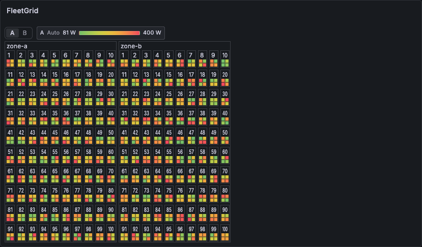
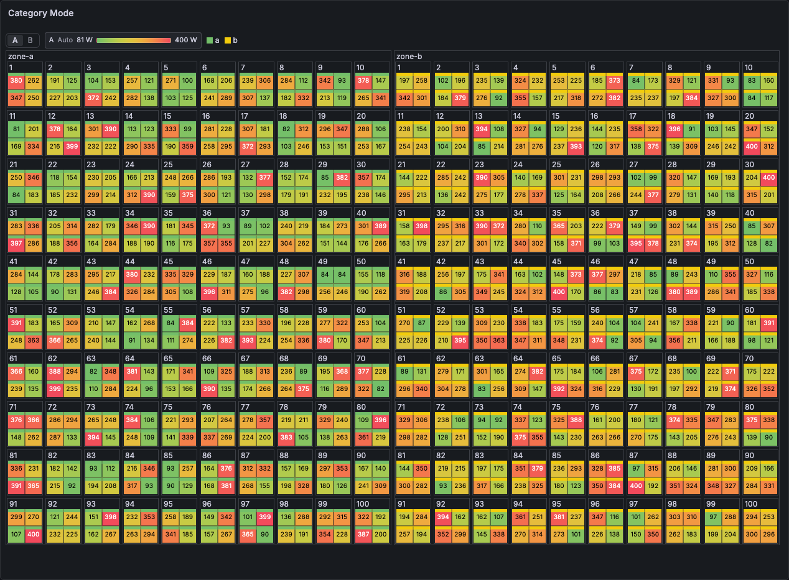
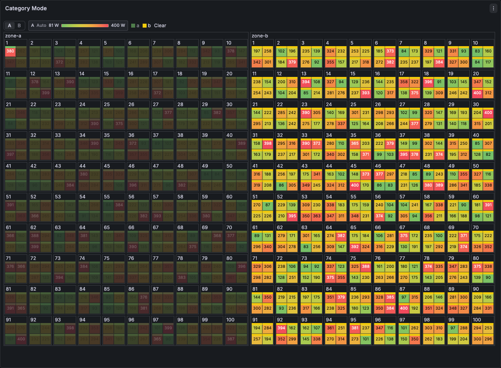
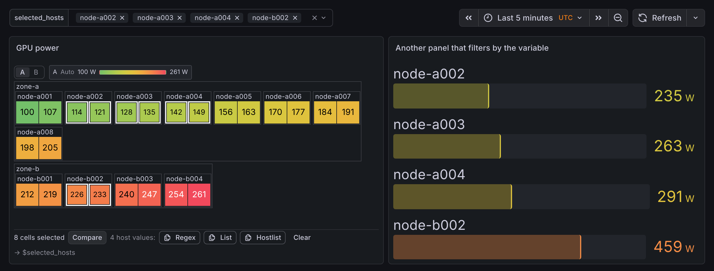
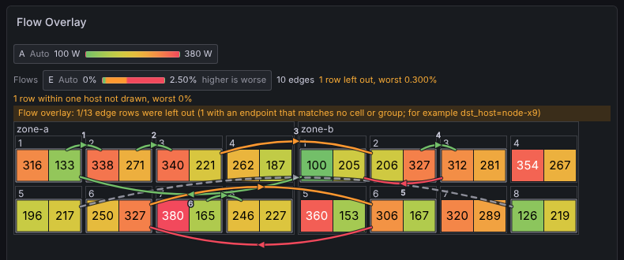

# FleetGrid

[](https://github.com/yuuki/grafana-fleetgrid-panel/actions/workflows/ci.yml)
[](https://github.com/yuuki/grafana-fleetgrid-panel/actions/workflows/security.yml)
[](https://github.com/yuuki/grafana-fleetgrid-panel/actions/workflows/is-compatible.yml)
[](https://github.com/yuuki/grafana-fleetgrid-panel/actions/workflows/release.yml)
[](./LICENSE)
[](https://claude.ai/claude-code)

A Grafana panel plugin that renders nested physical topologies — such as zones, hosts, and GPUs — as a hierarchical grid, and colors each cell by a Prometheus / VictoriaMetrics metric. It is designed for a bird's-eye view of large AI / HPC clusters, where hundreds of nodes and thousands of cells need to be scanned at a glance.

The panel draws every cell on a single `<canvas>` and overlays the tooltip, drilldown popover, legend, and metric selector as React DOM. Keeping the cells off the DOM is a deliberate design choice: the number of DOM nodes stays constant regardless of cell count, which avoids the per-cell React re-render and browser layout cost that a DOM-based grid would incur at the design target of a few thousand cells (up to ~15,000 sub-regions in split mode).



The example shows two zones and 200 nodes (100 per zone), with four GPU cells per node in a nested zone → host → GPU topology. Each cell is colored by the selected metric and the effective range is shown in the header.

## Features

- **Hierarchical grid** — Define an arbitrary number of nesting levels from your query labels (e.g. `zone` → `host` → `gpu`). Each level chooses its own layout (stack, row, flow-wrap, or grid) and sort order.
- **Grafana-native display with label-based ranges** — Unit, Decimals, value mappings, color scheme, Thresholds, and Data Links continue to use Grafana's **Field** and **Overrides** tabs. FleetGrid adds ordered label matchers only for choosing a cell's Min/Max; it does not add a threshold DSL.
- **Always-visible range legend** — The panel header shows a fixed gradient for a metric that uses one range. When cells use several ranges it says `Label-based ranges` instead of implying one fixed scale; hover shows the range that was actually applied.
- **Auto-fitted cells** — Cell size is computed from the panel dimensions. Numbers are drawn only when the formatted text fits; the exact value is always available on hover.
- **Natural sort** — Numeric segments inside labels are compared as numbers (`node-a2 < node-a10`), ascending by default (descending and "data order" are also selectable).
- **Multiple metrics** — Show one metric at a time with an in-panel selector (default), or opt in to split each cell into sub-regions to compare its metrics side by side. The tooltip and popover list every metric that returned data.
- **Cell selection and cohort comparison** — Shift+click cells or group labels, or Shift+drag a rectangle, to select any set of cells. Compare the selected cells with the rest of the grid for every query, copy their hosts as a regular expression, a list or a hostlist (`node-a[001-012]`), and optionally keep a multi-value or text box dashboard variable equal to them so that other panels filter by them.
- **Flow overlay** — Optionally draw the rows of one more query as arcs between cells or groups: pairwise metrics such as packet loss or round-trip time between hosts, or the ordered hops of a job's ring. Arcs take their color from Grafana's thresholds, can be limited to the degraded pairs, and are emphasised for the hovered cell.
- **Drilldown** — Click a cell to open a popover with the current value per metric, plus a sparkline whenever time-series data is available for that metric. If the field has Data Links, navigation takes priority over the popover.

## Compatibility

| Requirement | Value                          |
| ----------- | ------------------------------ |
| Grafana     | `>= 11.6.0`                    |
| Data source | Prometheus / VictoriaMetrics   |
| Query type  | Instant (recommended) or Range |

Coloring, units, and drilldown rely on Grafana's standard field config, so any data source that produces labeled numeric series can work, but the plugin is designed for Prometheus / VictoriaMetrics. The automated end-to-end tests run against Grafana's built-in TestData data source; verification against a live Prometheus / VictoriaMetrics instance — including the instant-query drilldown re-query — is still outstanding and recommended before production use.

The Latest Grafana API compatibility check compares local `@grafana/*` types against the latest published versions. A known Levitate false positive on `PanelPlugin.setMigrationHandler` (interface → type alias in Grafana 13) is listed in `.levignore.js`; other incompatibilities still fail CI. Reproduce locally with `npm run compat`.

## Quick start

### 1. Add queries

Add one or more numeric queries. Instant queries are recommended because the panel only needs the current value, which minimizes transfer. A range query is folded to a single current value per series (see [Reduce calculation](#data)).

```promql
# Query A — one series per (zone, host, gpu)
max by (zone, host, gpu) (gpu_power_watts)

# Query B — a second metric over the same topology
max by (zone, host, gpu) (gpu_temperature_celsius)
```

Every cell is built from the **union** of all queries, so a node present in only one query still appears in the grid; cells with no sample for the displayed query are painted with the missing color.

### 2. Configure hierarchy levels

Open the panel editor and add hierarchy levels under **Hierarchy**. The editor lists the label keys found in your query results and, for each level, shows the detected group count and sample values so misconfiguration is visible immediately.

| Level | Label  | Extract         | Layout             |
| ----- | ------ | --------------- | ------------------ |
| 1     | `zone` | As is           | Grid (columns: 2)  |
| 2     | `host` | Trailing number | Grid (columns: 10) |
| 3     | `gpu`  | As is           | Grid (columns: 2)  |

This `2 / 10 / 2` configuration reproduces a two-column top level, ten hosts per row within each top-level group, and two GPUs per row within each host. Levels are reorderable and there is no fixed depth limit (about 8 levels is a practical maximum).

### 3. Choose a color scheme

On the **Field** tab, set a **Color scheme** such as `Green-Yellow-Red (by value)` for a continuous gradient, or configure **Thresholds** for discrete colors. Set **Unit**, **Decimals**, and **Min/Max** as needed. Per-query settings (for example a different unit for temperature) go through **Overrides → Fields with name matching a query (by refId)**.

Each query's color scale is independent: a query with no explicit Min/Max is auto-scaled to its own data range, so a power metric (600–1000 W) and a temperature metric (30–90 °C) are not flattened onto one shared scale. The always-visible header legend formats its endpoints with the configured Unit and Decimals. It labels the range `Fixed`, `Auto`, `Min fixed`, or `Max fixed` according to which endpoints are explicitly configured.

When one query needs different limits by zone or pod, add rules under **Color scale overrides**. Rules are evaluated from top to bottom; the first rule whose optional refId and label conditions all match wins. Both table frames (string columns are labels) and time-series frames (`field.labels`) are supported.

## Options reference

### Hierarchy

Configured through the **Hierarchy levels** editor. Each level has:

| Setting      | Values                                       | Notes                                                                                                                                                                  |
| ------------ | -------------------------------------------- | ---------------------------------------------------------------------------------------------------------------------------------------------------------------------- |
| Label        | any detected label key                       | The label to group by at this level                                                                                                                                    |
| Extract      | `As is` / `Trailing number` / `Custom regex` | How to derive the level key from the label value. `Trailing number` turns `node-a004` into `004`; `Custom regex` uses the first capture group (e.g. `node-.+(\d\d\d)`) |
| Sort         | `Natural (asc)` / `Natural (desc)` / `None`  | `None` keeps data appearance order                                                                                                                                     |
| Layout       | `Stack` / `Row` / `Flow` / `Grid`            | Grid requires a column count                                                                                                                                           |
| Grid columns | number                                       | Only for the grid layout                                                                                                                                               |
| Border       | on / off                                     | Draw a border around each group                                                                                                                                        |
| Group label  | on / off                                     | Show the group label                                                                                                                                                   |

### Display

| Option                 | Default         | Description                                                                                     |
| ---------------------- | --------------- | ----------------------------------------------------------------------------------------------- |
| Display mode           | `Single`        | `Single` shows one metric with a selector; `Split` divides each cell into per-query sub-regions |
| Default metric (refId) | first query     | Which query the selector starts on in single mode                                               |
| Show values            | on              | Draw numbers when they fit; hover still shows the value when off or when text does not fit      |
| Extra tooltip labels   | empty           | Label names whose distinct values are listed in the cell tooltip, for example `partition`       |
| Missing color          | `rgb(70,70,70)` | Fill for cells with no sample for the displayed query                                           |

### Categorical decoration

Categorical decoration assigns a color to each distinct value of a selected label and draws it alongside the metric fill. Colors come from a fixed cool palette (blue, purple, cyan, magenta) chosen so they stay hue-orthogonal to the warm green→yellow→orange→red heatmap fill — the category signal never reads as magnitude. The fifth and later sorted values fold into a single neutral "other" grey rather than introducing more hues that would be hard to tell apart.

Two styles are available. **Bottom strip** (the default) paints a full-width band along the lower edge of each cell, giving a stable base line that stays clear of the centered value text. **Outline** draws a colored frame around each cell with a thin background gap inside it, so the frame color never bleeds into the metric fill; it remains visible in split mode around the metric sub-regions. The accompanying legend maps each color to its value and can be hidden independently.

Colors are deterministic for the current sorted value set, but are not pinned across value-set changes: adding a new value that sorts earlier can shift later colors. Cells without the selected label value receive no categorical decoration. For Slurm, set `categoryLabel` to `partition` for the `slurm_node_status` query from [SckyzO/slurm_exporter](https://github.com/SckyzO/slurm_exporter); choose `strip` or `border` with `categoryStyle` as appropriate.

Existing dashboards that use the legacy `categoryStyle: "topBar"` value are migrated to `strip` (Bottom strip) when loaded. The `border` value remains valid and uses the redesigned Outline rendering.

Legend chips highlight matching cells: **hovering** a chip previews the highlight for that value, and **clicking** locks it in. Locked selections toggle and can be combined, with multi-value cells matching when any value is selected; a hover temporarily overrides the locked selection and reverts when the pointer leaves. Highlighted cells are double-encoded — matching cells keep full brightness and gain a colored ring, while the rest dim. Use **Clear** to remove the locked selection. Dimmed cells remain hoverable and clickable, and this view-only selection is not saved to the dashboard.

#### Categorical decoration and legend highlighting

> Note: the screenshots below were captured from an earlier release and show the previous top-bar decoration, the old category palette, and no highlight ring. They illustrate the concept; the current defaults are the bottom strip, the fixed cool palette, and ringed highlights described above.



The `partition` label decorates each cell with its category color. The category legend maps the colors to `a` and `b`, while the metric fill continues to show the selected metric.



Selecting `b` in the category legend keeps matching cells bright and dims non-matching cells. Click **Clear** to restore the full grid.

| Option               | Default        | Description                                                                 |
| -------------------- | -------------- | --------------------------------------------------------------------------- |
| Category label       | empty          | Label whose values drive categorical cell colors; empty disables decoration |
| Category style       | `Bottom strip` | `Bottom strip` (band on the lower edge) or `Outline` (framed with a gap)    |
| Show category legend | on             | Show the categorical color/value legend in the panel header                 |

### Data

| Option              | Default           | Description                                                                                                                                      |
| ------------------- | ----------------- | ------------------------------------------------------------------------------------------------------------------------------------------------ |
| Spatial aggregation | `Max`             | Combines multiple series that fall on the same cell (e.g. when the hierarchy stops above the series granularity). `Max` / `Mean` / `Min` / `Sum` |
| Reduce calculation  | `Last (not null)` | Folds a range query into one current value per series. Limited to reducers that return a number                                                  |

### Color scale overrides

Each rule has an optional **refId** (blank means every metric), one or more label conditions, and at least one of **Min** or **Max**. Conditions within a rule are ANDed. `exact` compares the whole label value; `regex` uses JavaScript `RegExp` search semantics, so add `^` and `$` when a full-string match is required. The editor lists refIds, detected label names, and sample values, and supports adding, deleting, and reordering rules.

Rules are ordered and first-match-wins. An omitted endpoint falls back first to that metric's standard field-config endpoint and then to FleetGrid's existing automatic range. This makes min-only and max-only rules useful. Invalid regexes, rules without a range endpoint, and `min >= max` are reported in the editor and are not applied.

The following panel-options fragment gives GPU power query `A` a zone-specific maximum and bandwidth query `B` a maximum selected by both zone and bandwidth type:

```json
{
  "rangeOverrides": [
    {
      "refId": "A",
      "matchers": [{ "label": "zone", "operator": "exact", "value": "zone-a" }],
      "min": 0,
      "max": 700
    },
    {
      "refId": "A",
      "matchers": [{ "label": "zone", "operator": "exact", "value": "zone-b" }],
      "min": 0,
      "max": 650
    },
    {
      "refId": "B",
      "matchers": [
        { "label": "zone", "operator": "exact", "value": "zone-a" },
        { "label": "bw_type", "operator": "regex", "value": "^NVLink " }
      ],
      "min": 0,
      "max": 900
    },
    {
      "refId": "B",
      "matchers": [
        { "label": "zone", "operator": "exact", "value": "zone-a" },
        { "label": "bw_type", "operator": "regex", "value": "^(PCIe|NIC|Lustre|SONiC) " }
      ],
      "min": 0,
      "max": 400
    }
  ]
}
```

Add more ordered rules when another zone, pod, or bandwidth class needs a different maximum. Metrics such as GPU temperature, ECN marked packets, and PFC pause frames should have no matching rule when they need automatic scaling.

If a hierarchy extraction regex collapses several source label sets into one cell, all contributing labels must resolve to the same rule. A mix of rules, or of matched and unmatched labels, produces a warning and uses the standard field-config/automatic range for that cell; FleetGrid never chooses according to input order. Leaving `rangeOverrides` empty preserves the previous behavior exactly.

### Selection

| Option                     | Default   | Description                                                                                                                                                                                  |
| -------------------------- | --------- | -------------------------------------------------------------------------------------------------------------------------------------------------------------------------------------------- |
| Selection label            | automatic | Hierarchy label whose values are copied and synced for the selected cells. Empty: the copy buttons choose a label when a selection begins (see [Copy the selected hosts](#copy-the-selected-hosts)), and nothing is synced to a variable |
| Sync selection to variable | empty     | Name of a dashboard variable that receives the selected values. Needs **Selection label**. Empty disables the sync. See [Sync to a dashboard variable](#sync-to-a-dashboard-variable) for the variable types and limits |

Selecting cells needs no option: see [Cell selection](#cell-selection).

### Flow overlay

All options are in the **Flow overlay** category. The overlay is off while **Edge query (refId)** is empty, and the other options are hidden until it is set. See [Edges between cells](#edges-between-cells-flow-overlay) for what the options mean.

| Option                     | Default  | Description                                                                                                                                     |
| -------------------------- | -------- | ----------------------------------------------------------------------------------------------------------------------------------------------- |
| Edge query (refId)         | empty    | The query whose rows are edges. It is drawn as arcs and is no longer a cell metric. Empty turns the overlay off                                 |
| Endpoint labels            | none     | One or more mappings from a hierarchy label to the edge query's source label and destination label, for example `host` ← `src_host`, `dst_host` |
| Show arcs                  | `Always` | `Always` draws the arcs all the time; `On hover` draws only the arcs of the cell under the pointer                                              |
| Arcs at rest               | `100`    | The most arcs drawn while no cell is hovered: the worst ones. 1 to 500. A hovered cell always shows its own edges                               |
| Worse values are           | `Higher` | `Higher` for loss, latency and errors; `Lower` for throughput and success ratios. Sets the filter direction and which edges win the draw limit  |
| Only draw edges worse than | empty    | A number in the edge query's unit. Only edges strictly worse than it are drawn. Empty draws every edge                                          |
| Hop number label           | empty    | Label of the edge query with the position of an edge in an ordered path                                                                         |
| Path label                 | empty    | Label of the edge query that names the path an edge belongs to, for example a job ID                                                            |

## Multiple metrics

The cell model holds each query's value for a cell (marked missing where a query returned no series); only the drawing mode changes.

- **Single mode (default)** — Each cell is filled with the color of the selected metric. The header always shows the selected metric's range legend, including when the panel has only one query. With multiple queries, a selector to the left of the legend switches metrics with one click and the legend follows the selection. At widths of 480 px or more, a metric with one effective range shows its name, range state, formatted endpoints, and a horizontal color scale sampled from the same color processor as the cells. Below 480 px, it becomes a compact state icon and `min–max` badge. A metric using several effective ranges instead shows `Label-based ranges` and the range count. The selector lists every query, including one that returned no series (shown by its refId); selecting that query paints every cell with the missing color and keeps a `No data` legend visible without inventing range values. The selection is viewer-local state and is not saved as a dashboard change; the initial metric is the **Default metric** option (or the first query).
- **Split mode (opt-in)** — Each cell is auto-divided by the number of metrics that returned data: 2 = left/right, 3 = three columns, 4 = 2×2, 5–6 = 3×2, 7–9 = 3×3. Regions are capped at 9; with 10+ metrics only the first 9 are drawn and the legend notes the remainder. The header legend combines each region's position minimap with its metric name and either its single formatted range or `Label-based ranges`; entries wrap when space is limited. A query that returned no series gets no region. Values are not drawn inside split regions because they are inherently too small to read.

The tooltip (on hover) and the drilldown popover list every metric that returned data, regardless of mode. The tooltip also shows the hovered cell's actual formatted Min/Max, its `Fixed` / `Auto` / `Min fixed` / `Max fixed` state, and the matched label conditions or standard-range fallback.

For Slurm dashboards, `slurm_node_status` from [SckyzO/slurm_exporter](https://github.com/SckyzO/slurm_exporter) exposes a `partition` label per node; add `partition` to `tooltipLabels` to show it in the cell tooltip.

## Drilldown

Clicking a cell resolves in this order:

1. **Data Links** — If the field has Grafana Data Links configured, the click navigates. A single link is followed immediately; multiple links open a small link-selection menu the panel renders itself. Data Links always take priority.
2. **Popover** — Otherwise a card-style popover opens next to the cell, showing the hierarchy path and, per metric, the current value plus a sparkline when time-series data is available (see the instant-query note below); metrics without a time series show "No time series" instead. It auto-flips and clamps to stay inside the visible area and closes on outside-click or `Esc`.

**Instant query note** — When **any** of the panel's queries is instant (no time series in the received frames), clicking re-runs **all** of the panel's queries as range over the dashboard time range via the data source — a query configured as `format: table` is re-issued as `time_series` to request a time series, though whether a matching series actually comes back depends on the query and data source — capped at ~100 data points, then extracts the series matching the clicked cell. The result is cached per panel, so opening additional cells does not trigger another fetch. A failed re-query shows a short message in the popover; that error state is cleared only when the panel's query `requestId` changes (for example on the next dashboard refresh), which is what allows a retry. When the panel already runs range queries, no re-query happens. If re-querying feels slow at your scale, switch to range queries to remove it entirely. This instant-query drilldown path has not yet been verified against a live Prometheus / VictoriaMetrics data source.

## Cell selection

Select the cells that look wrong together, then compare them with the rest of the grid or act on their hosts. A selection is made with the Shift key and the primary button of a mouse or pen:



| Gesture                   | Effect                                                                                                                        |
| ------------------------- | ----------------------------------------------------------------------------------------------------------------------------- |
| Shift+click a cell        | Selects the cell, or takes it out of the selection when it is selected                                                        |
| Shift+click a group label | Selects every cell of the group (a zone, a host). When all of them are selected already, takes them all out                   |
| Shift+drag                | Draws a rectangle and adds every cell it overlaps. The rectangle shows how many cells it covers. Drags only add, never remove |
| Escape while dragging     | Abandons the drag; the selection stays as it was                                                                              |

Everything without Shift works as before: a plain click still opens the drilldown popover or follows Data Links, also on a selected cell, and never changes the selection. Shift is read when the button goes down, so releasing Shift before the button does not change the gesture. A drag may leave the panel; it ends where the button is released.

Selected cells get a ring in the theme's strongest contrast color. A bar appears under the grid with the size of the selection, **Compare**, three copy buttons and **Clear**. The grid keeps its layout when the bar appears: no cell moves, and the grid scrolls if the bar covers its last rows.

On a panel that draws a flow overlay, a selection leaves the arcs as they are; see [With cell selection](#with-cell-selection).

To clear the selection, use **Clear**, or press Escape while the keyboard focus is in the panel. After a selection gesture the focus is on the bar, so Escape works at once. While a drilldown popover or a link menu is open, Escape leaves the selection as it is. Changing the hierarchy levels also clears the selection.

The selection belongs to the viewer and is not saved in the dashboard; like the selected metric, it ends when Grafana re-creates the panel, for example when the panel view opens. It names cells by their hierarchy path, not by their position, so it stays on the same cells when the data refreshes, the panel is resized or the metric is switched.

What a selection means does not change while it exists. Each cell is remembered with the label values it had when it was selected. A selected cell that disappears from the query results stays selected: the bar counts it as "not in the current data" and it takes no part in the comparison, because it has no value now. Its label values stay in the copies and in the synced variable, and the bar says how many values come from such cells ("2 host values (1 from cells not in the current data)"). The cell is ringed again when it comes back.

Limits: cells cannot be selected with the keyboard or by touch (the grid is a canvas without keyboard navigation, and touch has no Shift key); the bar and the comparison are ordinary buttons and work with the keyboard. There is no freeform lasso: build other shapes from rectangles and Shift+clicks. A drag does not scroll the grid; scroll, then drag again.

### Cohort comparison

**Compare** opens a drawer that compares the selected cells with all other cells of the grid, for every query that gives the cells a value (the edge query of a [flow overlay](#edges-between-cells-flow-overlay) is not one). Each cell counts with the value the grid shows for that query.

| Column     | Meaning                                                                                                                                                                                                                                 |
| ---------- | --------------------------------------------------------------------------------------------------------------------------------------------------------------------------------------------------------------------------------------- |
| With value | Cells that have a value for the query                                                                                                                                                                                                   |
| No value   | Cells that have none. They are not counted as zero and are left out of the statistics                                                                                                                                                   |
| Min, Max   | Lowest and highest value                                                                                                                                                                                                                |
| Median     | The middle value. With an even number of values, the mean of the two middle values                                                                                                                                                      |
| p95        | The value at position `0.95 × (n − 1)` of the sorted values, interpolated between its two neighbours (the definition of PromQL `quantile`, NumPy and spreadsheets). In a group of up to 21 cells it lies between the two highest values |
| δ          | Cliff's delta, a measure of how far the two groups overlap                                                                                                                                                                              |

δ compares every selected cell with every other cell: the share of pairs in which the selected cell is higher, minus the share in which it is lower.

- `+1.00`: every selected cell is higher than every other cell. The two groups do not overlap.
- `−1.00`: every selected cell is lower.
- `0.00`: a selected cell is as often higher as lower, as it is when the two groups have the same distribution.

The further δ is from 0, the more that query tells the selection apart from the rest. δ uses only the order of the values, so one extreme cell cannot dominate it. It compares levels, not spread: a selection that holds both the highest and the lowest cells has a δ near 0, and Min and Max show the difference. δ is empty when either group has no value.

### Copy the selected hosts

The copy buttons copy the distinct values that the selected cells have for one label, in natural order. The bar names the label and the number of values ("3 host values:").

That label is the **Selection label** option. When the option is empty, FleetGrid chooses a label at the moment a selection begins: the deepest hierarchy level whose values are unique in the grid at that moment. For `zone` → `host` → `gpu` that is `host`, because `gpu0` exists under every host. The choice depends on the data on screen (with one host on screen, `gpu` is unique), so set the option when the label matters. The chosen label stays the same until the selection is cleared, whatever the data does.

| Button   | Example                         | Notes                                                                                                                                                                                               |
| -------- | ------------------------------- | --------------------------------------------------------------------------------------------------------------------------------------------------------------------------------------------------- |
| Regex    | `^(node-a001\|node-a002)$`      | Matches exactly the selected values. See below for pasting it into a quoted string                                                                                                                  |
| List     | `node-a001,node-a002`           | A value that contains a comma or a double quote is quoted as in CSV                                                                                                                                 |
| Hostlist | `node-a[001-003,007],node-b012` | The notation of Slurm and pdsh. Zero padding is kept (`node-a[001-012]` is not `node-a[1-12]`). Names that differ in more than one number are listed separately. See below for what it cannot write |

**Regex.** The text is a correct regular expression for RE2 (PromQL, LogQL), PCRE and JavaScript, and for `grep -E` unless a value contains a line break. Regular expression characters in a value are written as one-character classes (`node-a001[.]example`, `[[]fd00::1]:9100`) and a line break as `\n`, so for most values the text has no backslash and can stand between the double quotes of a PromQL or LogQL matcher as it is: `host=~"…"`. Three characters have no such form: a backslash, `^` and a double quote. When a selected value contains one of them, the bar shows a warning. The copied text is still a correct regular expression, but inside a quoted string it needs the escaping of that string; pasted as it is, the query fails, or, for a backslash, matches other values.

**Hostlist.** The button is disabled when a value is empty or contains `,`, `[`, `]` or white space: the notation has no way to write these, and Slurm and pdsh read white space as a separator. Text after the bracket, as in `node-a[01-03].example.com` or `node[01-03]-ib`, is read by pdsh and by Slurm 23.11 and later. Slurm 23.02 and earlier reject it; for those versions, list such hosts with the **List** button.

If the browser does not allow access to the clipboard, the bar shows the text in a field so that it can be selected and copied by hand. The field goes away when the selection changes.

### Sync to a dashboard variable

Set **Sync selection to variable** to the name of a dashboard variable, set **Selection label** to the label whose values the variable is to hold, and use the variable in the queries of other panels. FleetGrid then keeps the variable equal to the values that the selected cells have for that label. Without a selection label nothing is written, and the bar says so: a label that FleetGrid chooses from the data on screen is good enough for a copy, but not for filtering other panels.

| Variable                                                        | Synced | What it receives, or why it is refused                                                                                                                                                                                         |
| --------------------------------------------------------------- | ------ | ------------------------------------------------------------------------------------------------------------------------------------------------------------------------------------------------------------------------------ |
| Custom or query variable with **Multi-value**                   | Yes    | The values themselves. Grafana formats and escapes them for each query: `host=~"$selected_hosts"`                                                                                                                              |
| Text box                                                        | Yes    | One regular expression, `^(node-a001\|node-a002)$`: `host=~"$selected_hosts"`                                                                                                                                                  |
| Custom or query variable without **Multi-value**                | No     | It holds one of its options. A regular expression is not one of them: Grafana puts a query variable back to an option at the next refresh, and with **Include All option** the data source escapes the expression so that it matches nothing |
| Constant, interval, data source, ad hoc filters, any other type | No     | It holds something else than label values                                                                                                                                                                                      |

The bar shows the state of the sync after **Clear**:

| Bar                                                   | Meaning                                                                                                                                              |
| ----------------------------------------------------- | ---------------------------------------------------------------------------------------------------------------------------------------------------- |
| `Writing $name…`                                      | The values were written and Grafana does not show them in the variable yet                                                                           |
| `→ $name`                                             | FleetGrid read the variable back, and it holds the selection. `(with 1 other panel)` is added when other FleetGrid panels have a selection in it too |
| `$name holds only 1 of the 2 selected values`         | A multi-value variable lost a part of the selection and holds nothing else: Grafana dropped values that are not among its options, or a viewer unticked them |
| `$name was changed and no longer holds the selection` | The variable held the selection and now holds a value that FleetGrid did not write: a viewer chose it, or Grafana replaced the selection with it     |
| `Grafana did not keep the selection in $name`         | Grafana never showed the written values, and the variable holds something else. FleetGrid leaves that value alone                                    |
| Any other text                                        | The reason why nothing was written, for example `Variable "name" takes one value: sync to a multi-value variable or a text box`                      |

How the sync behaves:

- **Read back.** FleetGrid shows `→ $name` only after it has read the variable and found the selection in it. It reads the variable again every second and whenever the URL changes, so the bar follows what Grafana and viewers do with the variable.
- **When it writes.** The variable is written 0.4 s after the selection last changed, and only when the selected values changed. A data refresh writes nothing. This also holds when the panel's own query uses the variable: the grid then shows only the selected hosts, and the selection and the variable stay as they are.
- **Hosts that leave the data** stay in the variable. The variable holds the label values that the cells had when they were selected, so a host that stops reporting is still filtered for in the other panels.
- **Values, not cells.** The variable holds the values of one label. If the same value exists in two groups, for example the same host name in two zones, a query that filters by the variable matches both.
- **Clear.** When the selection is cleared, the variable gets back the value it had before the first write, for example **All**. This happens only while the variable still holds the selection or a part of it. FleetGrid never writes over a value that it did not put into the variable, except with a new selection: after `$name was changed…` or `Grafana did not keep…` it does not write the selection again and does not put an older value back. The next change of the selection writes again, and Clear then puts back the value that the variable had at that moment.
- **Several panels.** Several FleetGrid panels, and the copies of a repeated panel, can sync to one variable. The variable holds the selections of all of them together. Clearing one panel leaves the values of the others; clearing the last one puts back the original value.
- **Options of a query variable.** Grafana accepts values that are not among the options of a multi-value variable. A query variable loses them when it loads its options again (with **Refresh: On time range change**, at every dashboard refresh). When some selected values are among the options, the variable keeps those, the bar says `$name holds only … of the … selected values`, and **Clear** puts the previous value back. When none is, Grafana sets the variable to a value of its own, the bar says `$name was changed…`, and that value stays after **Clear**. Sync to a variable whose options contain every host of the grid, to a custom variable or to a text box.
- **Values that are not written.** A selected value that is equal to `$__all` is not synced to a multi-value variable, because Grafana reads it as **All**. A value with a backslash, `^` or a double quote is not synced to a text box, because whether its regular expression reaches a query unchanged depends on the data source. A multi-value variable that has no value at all is not written, because its state could not be put back. The bar says which of these applies.
- **URL length.** The values are written to the dashboard URL (`var-<name>=…`). A selection that would add more than 6,000 characters to the URL is not synced: the bar says so and the variable gets its previous value back. Select fewer cells, or use the copy buttons.
- **How a value reaches a query** is decided by Grafana and by the data source of the panel that uses the variable. With Grafana's Prometheus data source, a multi-value variable is exact for every value except one that contains a double quote or a line break, for which the query of the other panel fails with an error.
- **Panel view and editor.** When Grafana re-creates the panel on the same dashboard (for example when the panel view or the panel editor opens), the selection ends, and the variable gets its previous value back as with **Clear**.
- **No restore from the variable.** After a page reload, or after leaving the dashboard and coming back with the browser's Back button, the variable still has its value from the URL and the panel has no selection; reset the variable with its own picker.

## Edges between cells (flow overlay)

Cells show the state of one endpoint. Many faults in an AI / HPC cluster are between two endpoints: a lossy link between two hosts, pause frames that spread from one rack to another, or one slow hop in a job's ring. The flow overlay draws such pairwise data as arcs on top of the grid.



The example shows two zones of eight hosts with two GPUs each. The edge query names hosts, so the arcs run between host groups: each group that has an edge is outlined, and its arcs meet in a dot at its centre. The numbered arcs are the six hops of one ring. The two arcs between the hosts numbered 6 are the two directions of one pair, and the dashed arc is an edge without a value. The header says which end of the color scale is the worse one and how many rows have no arc; the banner gives an example of an edge row whose destination is not in the grid.

### The edge query

Add one more query that returns **one row (or series) per directed pair**, and enter its refId under **Edge query (refId)**. The row needs a label for the source, a label for the destination and a numeric value:

```promql
# Query E — packet loss between hosts, one series per (src_host, dst_host)
max by (src_host, dst_host) (fabric_probe_loss_ratio)
```

- The overlay is bound to a query by its refId, never by label names. A dashboard whose queries happen to carry labels such as `src_host` does not change until an edge query is named. Spaces around the refId and around the label names of the options are ignored.
- The edge query is taken out of the cell pipeline. It does not create cells, is not offered in the metric selector, is not part of the drilldown re-query, and has no row in the cohort comparison of a cell selection. Its labels and its refId are not offered by the editors of the cell options either (hierarchy levels, tooltip labels, category label, range overrides).
- An edge query that returns **no rows** draws nothing and raises no warning; the header says `no edges`. This is the healthy state of a query that filters in the data source (`> 0`). When **no query with that refId ran** (it does not exist, or it is hidden), the banner and the header say so.
- Time-series frames and table frames are both read, as for cells. A range query is reduced with the panel's **Reduce calculation**. In a table, the first numeric column that is not one of the configured labels is the value.
- Unit, decimals, color scheme and **Thresholds** of the arcs come from Grafana's standard field config. Use **Overrides → Fields returned by query** for the edge query to give it its own unit and thresholds.
- Without Min/Max in the field config, the color range of the arcs is automatic, by three rules: it spans every edge that has a value, **before the filter**; it includes the filter's number; and when higher is worse it starts at 0 or below. So a filter does not change the color of an edge, and a query that returns only its degraded pairs does not paint the least degraded one in the color of the healthy end. A Min or a Max that you set, in the standard options or in an override for the edge query, always wins, each end on its own. An automatic range is still relative to the data: for colors with a fixed meaning, set **Thresholds** or Min/Max for the edge query.
- **Worse values are** does not change colors, because the color scheme is yours to choose. For a metric where lower is worse, choose a color scheme or thresholds whose low end is the alarm color (for example `Red-Yellow-Green`); with `Green-Yellow-Red` a low value is green. The header's scale therefore says in words which end is the bad one: `higher is worse` or `lower is worse`.
- Frames are selected by their refId, so a transformation that merges the queries into one frame also removes the edge query.

### Matching endpoints to the grid

**Endpoint labels** says which hierarchy label an endpoint label refers to. The value of the endpoint label is compared with the **raw** value of that hierarchy label in the cell queries, before the level's extraction. So `src_host="node-a001"` matches the cells with `host="node-a001"` even when the host level shows only the trailing number.

- An endpoint resolves at the **deepest mapped hierarchy level**. With `zone` → `host` → `gpu` and a mapping for `host` only, an edge runs between two host groups. Each of the two groups is outlined, and the arc ends at the centre of the group under a small dot in the color of the outline (the group's hub), so it is not mistaken for an edge of the cell in the middle of the group. Add a second mapping (`gpu` ← `src_gpu`, `dst_gpu`) to run the edges between GPU cells.
- Map every label that is needed to name one cell or group. `gpu0` alone exists under every host, so mapping only `gpu` matches more than one cell and the row is left out.
- Every mapping must be complete and must name a hierarchy label. Otherwise nothing is drawn and the banner says why, because a skipped mapping would move the edges to another level.
- The two directions of a pair are two edges and two arcs. An arc bulges to the left of its direction of travel and carries an arrowhead at its middle. Where the grid is narrower than the panel, an arc can bulge into a margin beside the grid (up to 160 px, and never more than the grid's own width). An arc never leaves that area: where it has no room on its own side, it bulges to the other side or bulges less, down to a straight line in a very narrow grid.
- Rows of the same ordered pair are one edge, for example the RNIC pairs of one host pair. Its value is the **worst** of them: the highest when **Worse values are** is `Higher`, the lowest when it is `Lower`. So one degraded row is never hidden by healthy ones. The cells' **Spatial aggregation** is not used for edges; to add rows up (byte rates, for example), aggregate in the query with `sum by (src_host, dst_host)`.
- An edge whose rows have no finite value is kept and drawn **dashed in a neutral color**. It is never treated as 0. A missing value can mean that the path is the most broken one, so these edges are not the first to go when more edges remain than can be drawn: they get the room that the edges with a value leave free, and at least half of the limit. With a filter they are not drawn, because they cannot be compared. In both cases the header says how many are not drawn.

Rows that cannot be drawn are counted and reported; they are never dropped silently. The warning banner gives the number of rows without an endpoint label, with an endpoint that matches no cell or group (with up to three examples), and with an endpoint that matches more than one. A row whose two ends resolve to the same cell or group (a self-edge) has no arc. The header gives both numbers in its visible text, each with the worst value among those rows, for example `3 rows left out, worst 4.5%` and `2 rows within one host not drawn, worst 1%`. A degraded row that has no arc is therefore still reported, also in a panel that is too narrow for the banner.

### Filter, limits and legend

- **Only draw edges worse than** keeps the edges strictly worse than a number: above it when **Worse values are** is `Higher` (for example loss > 0, or RTT above the objective), below it when `Lower` (for example throughput below the objective).
- **Arcs at rest** is the most arcs drawn while no cell is hovered: **100** by default, 500 at most. When more edges remain, the worst ones are drawn (ties are broken by the endpoints, so the choice does not depend on the order of the query result), and the header says so in the warning color. The number is low on purpose. A few hundred arcs cover the cells and each other, and the one bad edge is then no easier to find than without the overlay. Do not raise the number to see more: filter instead, with **Only draw edges worse than** or in the query, so that the arcs at rest are the degraded paths only. To read all edges of one host, hover it, or use **Show arcs: On hover**.
- At most **500 arcs** are drawn for a hovered cell.
- The arcs are drawn on two canvases of at most twice the size of the cell canvas. A grid so large that the browser cannot paint such a canvas (in Chromium: more than 65,535 device pixels high, for example about 32,000 px of grid at display scaling 2) gets no arcs, and the header says `… edges not drawn: the grid is too large for the overlay`.
- At most **20,000 rows** of the edge query are turned into edges. Of a larger result the panel reads the value of every row and uses the **worst 20,000 rows**, wherever they are in the result, so the worst edge is not lost. The rows it leaves out are the least bad ones. Reading the values of a very large result still costs time (about 0.25 s for a million rows), and pairwise data grows with the square of the fleet: narrow a large edge query in the data source, for example with `topk` or a `> 0` comparison. The limit is applied **before** the endpoints are matched to the grid. If the edge query also returns pairs of hosts that are not in this panel, those rows count towards the 20,000, and an edge inside the grid can be among the rows that are not read. The header then says how many rows were not read, and the banner asks to restrict the query to the hosts of this panel (for example with the same label matchers as the cell queries).
- The header shows the edge query's color scale and how many edges are drawn, for example `12 of 240 edges > 0%` or `100 of 4032 edges drawn, worst first`. It also says, in text that wraps in a narrow panel, when the picture is incomplete: `worst 20000 of 25001 rows used`, how many edges without a value are not drawn, and how many rows have no arc. When nothing can be drawn, it gives the reason in a few words, for example `no query "E"` or `endpoint mapping incomplete`.
- The warning banner is one line and cuts long warnings; hover a warning to read it in full. Everything that says the picture is incomplete is also in the header, which wraps.

### Hover

Hovering a cell emphasises the edges of that cell, or of its group when the edges run between groups, outlines the cells or groups at their other ends, and dims the remaining arcs. The cell tooltip adds the number of outgoing and incoming edges, the number of peers and the worst peer with its value. A hovered cell can show edges that **Arcs at rest** left out of the resting picture; the filter always applies.

While the drilldown popover of a cell is open, its edges stay emphasised when the pointer leaves the grid, is on the popover, or is on a cell that has no edges. Hovering a cell that has edges shows that cell's edges instead. The tooltip always describes the hovered cell.

With **Show arcs: On hover** nothing is drawn until a cell is hovered. Use it with an unfiltered edge query to see all peers of one host at a time.

### With cell selection

[Cell selection](#cell-selection) works on a panel with a flow overlay, and the two do not change each other:

- While Shift and the button are held, the pointer selects and does not hover. The tooltip and the emphasis of the hovered cell's edges end when the button goes down, and a drag over other cells emphasises nothing. The next pointer move after the release hovers again.
- An open drilldown popover keeps the edges of its cell emphasised for as long as it is open, also during a Shift press. Selecting does not close the popover in Grafana 12.4, so close it first when the arcs are to be at rest while you select. (In Grafana 11.6 any press outside the popover closes it, and the emphasis ends with it.)
- A selection does not emphasise the edges of the selected cells, and it does not hide or dim any arc. Hover a selected cell to see its edges, as for any other cell.
- The ring of a selected cell is drawn with the cell, so arcs run over it as they run over the cell's color. The rectangle of a Shift+drag is drawn over the arcs.
- The cohort comparison lists the cell queries only. The edge query has no value per cell, so it has no row there, and the copy buttons and the variable sync use the labels of the cells, never the source and destination labels of the edge query.

### Ordered paths

To show a communication path such as a ring, give each edge row its position on the path:

| `src_host` | `dst_host` | `job`    | `hop` | value |
| ---------- | ---------- | -------- | ----- | ----- |
| `node-a1`  | `node-a2`  | `ring-a` | `1`   | 0     |
| `node-a2`  | `node-b1`  | `ring-a` | `2`   | 0.4   |
| `node-b1`  | `node-a1`  | `ring-a` | `3`   | 0     |

Set **Hop number label** (`hop`) and, when several paths are shown together, **Path label** (`job`).

- Every hop is a row with its own source and destination, so the panel does not infer hops from a list of members. A ring is a path whose last hop returns to the first source; an open path simply ends. A tree is a set of hops that share sources: number its hops by depth, or leave the hop number out and set only the path label.
- The hop number is written beside the arrowhead. Where numbers would overlap, the lowest ones are kept. An arc that carries several hops (the same pair on two paths, or twice on one path) shows the first of them, by path name and then by number, followed by `+`.
- Hovering a cell on a path emphasises the **whole path**, not only the hops at that cell. The tooltip lists the hops that enter and leave the cell.
- Hop numbers must be whole numbers from 0. A row with another value keeps its arc, loses its number and is counted in a warning. Gaps in the numbers are shown as they are: a missing number means that hop is absent from the query result, has an endpoint outside the grid, or is hidden by the filter.
- The same pair on two paths is one arc with one value, the worst of its rows.

The overlay has no animation. The direction of a flow is shown by the arrowhead, so a dashboard with many panels does not run a render loop.

## Layout notes

Grid layouts fill groups in row-major order within each parent: with two columns, items `0` and `1` occupy the first row, followed by `2` and `3` on the next row. Configure each hierarchy level independently; for example, the Quick start's `2 / 10 / 2` column counts produce the fixed nested layout described above.

Cell size is auto-fitted between **6 px** and **40 px** by scanning candidate sizes from large to small and taking the largest that fits the panel. If even 6 px cells do not fit, the size is pinned to 6 px. The panel then scrolls **vertically** when the content is taller than the panel and **horizontally** when it is wider. While scrolling vertically, the current top-most level's group label stays pinned to the top — but only when that top level has its **Group label** enabled, since otherwise there is no label to pin.

On Grafana Auto Grid with **Auto fit content**, the panel ignores the allocated height and instead uses the width-constrained cell size (usually 40 px) so the panel chrome shrinks to the grid. Min/max height and overflow stay on the Auto Grid cell. Classic / custom grid layouts still use the fixed panel height.

## Deployment

The plugin is not yet published to the Grafana catalog and its release builds are unsigned, so it must be installed manually.

### 1. Get the build

- **From a GitHub Release** — download the `yuuk1-fleetgrid-panel-<version>.zip` asset attached to the release (built by `.github/workflows/release.yml` whenever a `v*` tag is pushed).
- **From source** — run `npm install && npm run build`; the output is written to `dist/`.

### 2. Install into Grafana

Copy (or extract) the build into Grafana's plugin directory as a folder named after the plugin ID:

```bash
cp -r dist "$GF_PATHS_PLUGINS/yuuk1-fleetgrid-panel"
```

Because the plugin is unsigned, Grafana refuses to load it unless it is explicitly allow-listed. Set the following on the Grafana server (or in `grafana.ini` under `[plugins]` as `allow_loading_unsigned_plugins`) before starting/restarting it:

```bash
GF_PLUGINS_ALLOW_LOADING_UNSIGNED_PLUGINS=yuuk1-fleetgrid-panel
```

### SSH deployment

To build locally and deploy `dist/` over SSH, run `scripts/deploy-plugin-ssh.sh` from the repository. `DEPLOY_HOST` is required; the other settings are optional:

```bash
DEPLOY_HOST=grafana.example.com \
DEPLOY_USER=deployer \
REMOTE_SUDO=1 \
RESTART_GRAFANA=1 \
scripts/deploy-plugin-ssh.sh
```

The script supports `DEPLOY_PORT`, `REMOTE_PLUGIN_DIR`, `PLUGIN_OWNER`, and `GRAFANA_SERVICE`. With `REMOTE_SUDO=1`, if `sudo` on the remote host needs a password, the script prompts for it once per run (or reads `DEPLOY_SUDO_PASSWORD` when there is no terminal) and passes it to `sudo -S` over the SSH session's stdin. It does not configure Grafana's unsigned-plugin allow-list, so configure `GF_PLUGINS_ALLOW_LOADING_UNSIGNED_PLUGINS=yuuk1-fleetgrid-panel` on the remote Grafana host separately.

### 3. Docker / docker-compose example

```yaml
services:
  grafana:
    image: grafana/grafana:11.6.0
    ports:
      - '3000:3000'
    environment:
      - GF_PLUGINS_ALLOW_LOADING_UNSIGNED_PLUGINS=yuuk1-fleetgrid-panel
    volumes:
      - ./dist:/var/lib/grafana/plugins/yuuk1-fleetgrid-panel
```

### 4. Verify

Restart Grafana, then add a panel and confirm **FleetGrid** appears in the visualization picker. Check **Administration → Plugins** to confirm the plugin loaded without errors if it does not appear.

## Development

**Prerequisites:** Node.js `>= 26` (see `.nvmrc`) and Docker (for `npm run server` and the e2e Grafana instance). Before the first `npm run e2e`, install the Playwright browser once with `npx playwright install chromium`.

```bash
npm install

# Build in watch mode
npm run dev

# Production build
npm run build

# Type check and lint
npm run typecheck
npm run lint

# Unit tests (Jest)
npm run test:ci

# Run a local Grafana with the plugin (Docker)
npm run server

# Pin a Grafana version for the dev server / e2e
GRAFANA_VERSION=11.6.0 npm run server

# End-to-end tests (Playwright, @grafana/plugin-e2e) — needs a running server
npm run e2e

# Cognitive / Cyclomatic complexity (needs the cccc binary, see below)
cccc --table src

# Everything the pull request CI checks without Docker (see CONTRIBUTING.md)
make check
```

[CONTRIBUTING.md](./CONTRIBUTING.md) describes how to propose a change, and [AGENTS.md](./AGENTS.md) says which checks to run when, and lists the compatibility contracts and the Git conventions. Report security issues as described in [SECURITY.md](./SECURITY.md).

Function complexity is measured with [cccc](https://github.com/moznion/cccc) and tracked as a trend rather than a score: the `Complexity` workflow sends cccc's summary (total, max, median and p90 of each metric) to [octocov](https://github.com/k1LoW/octocov) as custom metrics. octocov comments the before/after values on pull requests and stores a report for every push to `main` on the data-only `octocov` branch. The job summary lists the top functions by complexity. The `max-cognitive` / `max-cyclomatic` thresholds in `cccc.toml` stay as a fixed backstop against extreme outliers, and the workflow fails when a function exceeds them. To run cccc locally, download a binary from the [cccc releases](https://github.com/moznion/cccc/releases) or install it with `cargo install cccc-cli`.

The build uses the webpack configuration provided in `.config/`. Data transformation (`src/data`), layout (`src/layout`), and hit testing (`src/render`) are pure functions verified directly with Jest; the canvas render layer is intentionally thin.

## Acknowledgements

FleetGrid was inspired by [HewlettPackard/hpe-grafana-clusterview-panel](https://github.com/HewlettPackard/hpe-grafana-clusterview-panel), whose approach to presenting cluster topology in Grafana helped inform this project's direction. FleetGrid builds on that inspiration with its own hierarchical, canvas-based rendering approach.

## License

Apache-2.0. See [LICENSE](./LICENSE).
